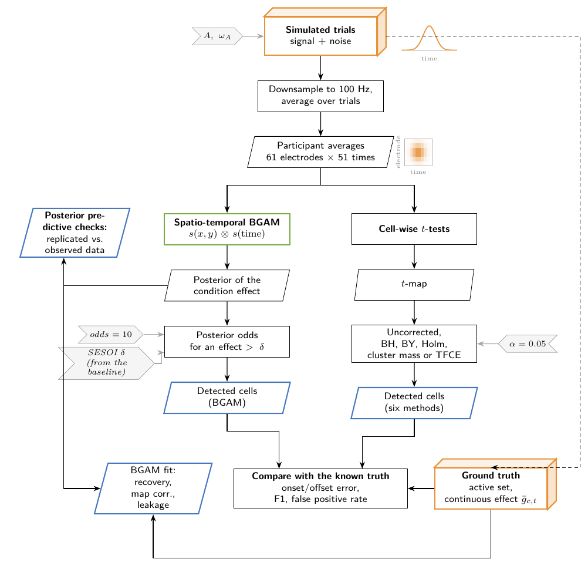
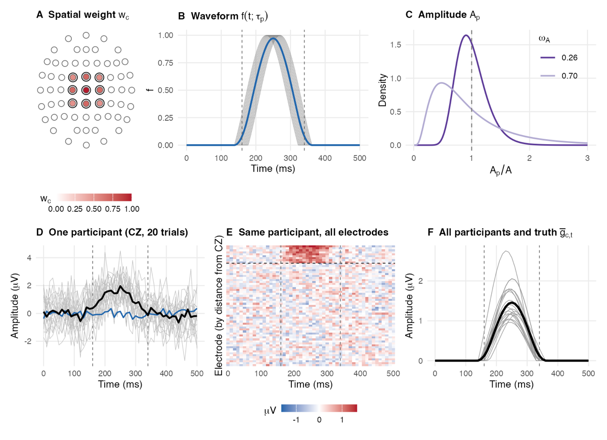
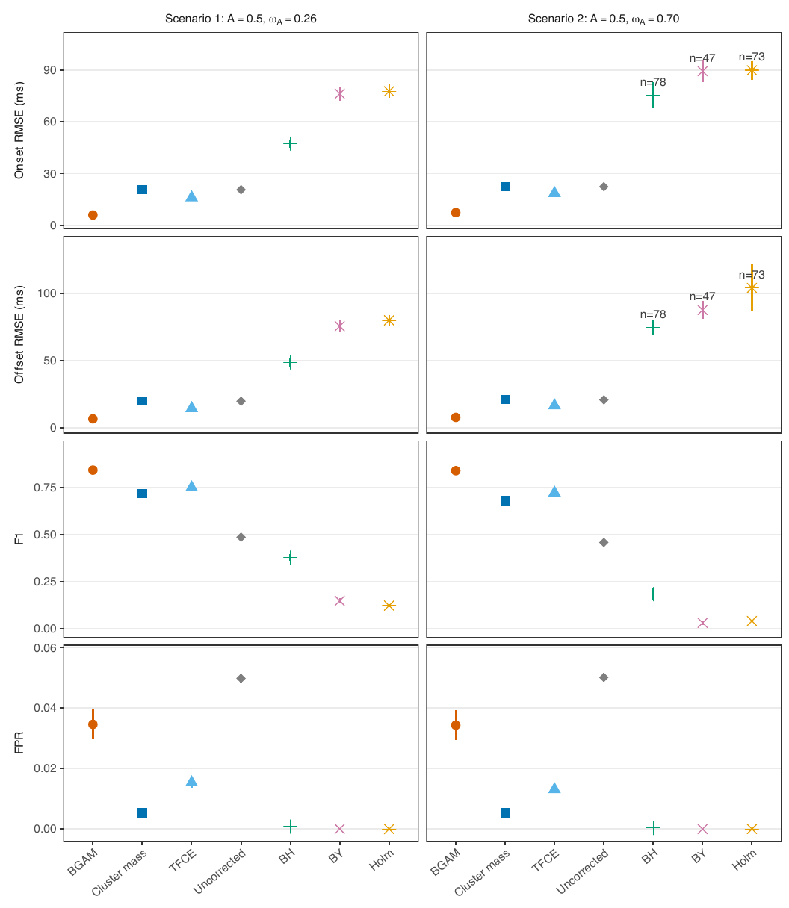
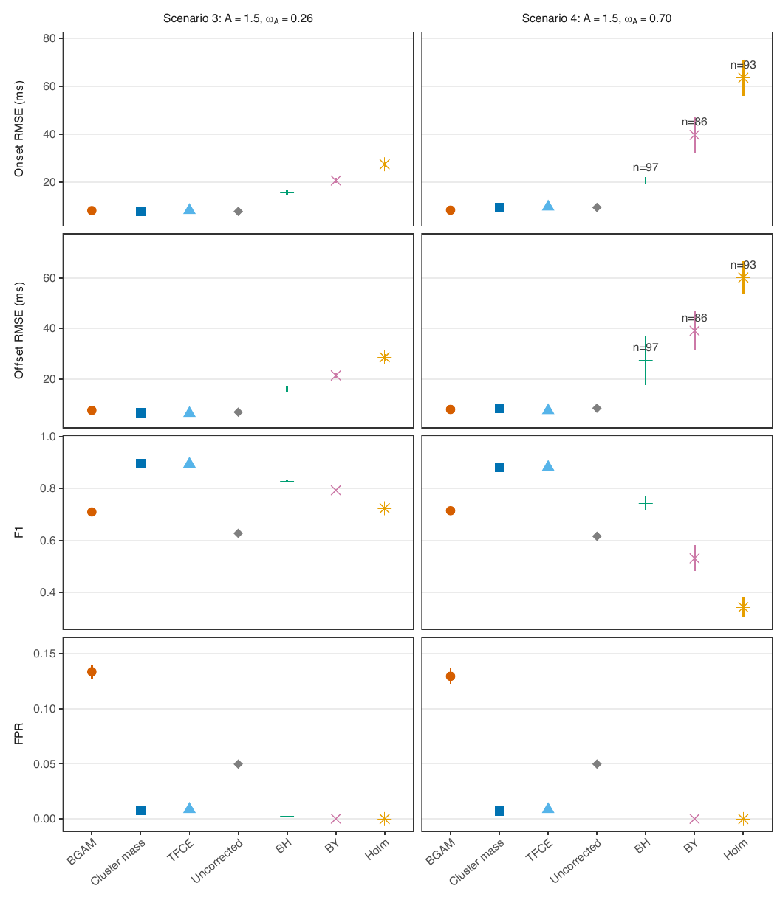
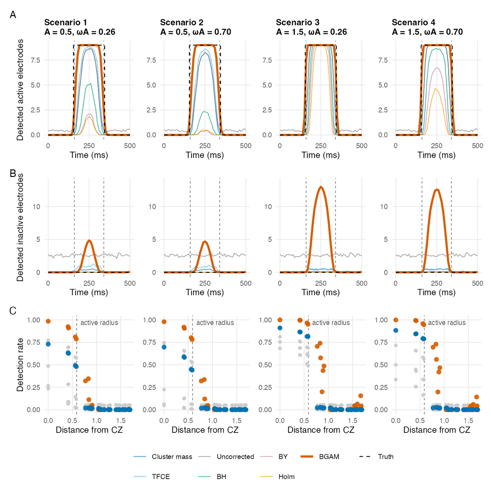
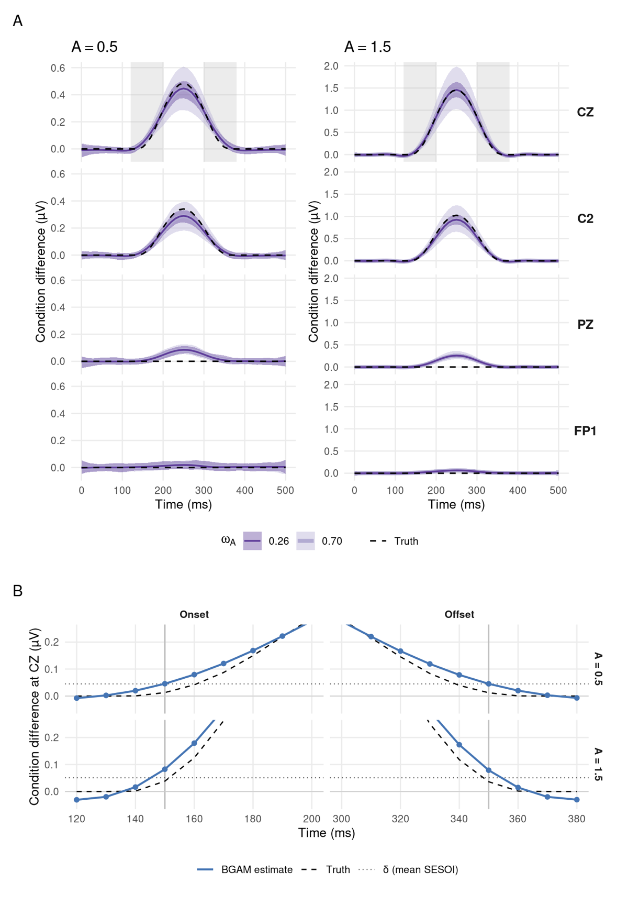
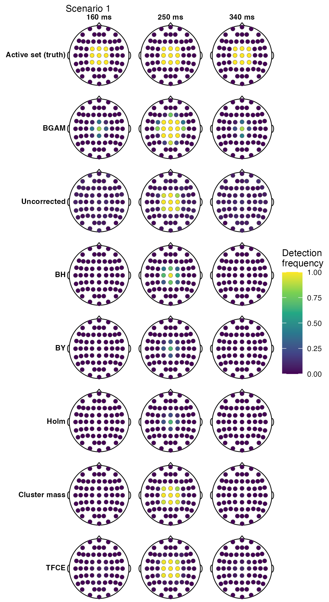

# Spatio-temporal EEG modelling with Bayesian GAMs

Code for a master's thesis at TU Dortmund University. The study compares a Bayesian generalised additive model (BGAM) with six conventional methods for detecting **when and where** simulated EEG effects occur.

## Study

We simulate 100 datasets in each of four scenarios, with 20 participants and 61 electrodes per dataset.

| Scenario | Effect amplitude (µV) | Between-participant heterogeneity |
|---|---:|---:|
| 1 | 0.5 | 0.26 |
| 2 | 0.5 | 0.70 |
| 3 | 1.5 | 0.26 |
| 4 | 1.5 | 0.70 |

Of 400 BGAM fits, **362 meet the convergence criteria**. The analysis compares detection accuracy, timing error, false positives and effect recovery.

## Method



*Overview of the simulation study. Simulated trials are averaged and analysed by the BGAM and by six conventional methods. All detections are compared with the known truth.*

We simulate EEG data with a known effect in space and time, fit a Bayesian GAM, and compare it with six conventional detection methods.



*How the simulated signal is built: the spatial weight of each electrode, the waveform, the amplitude of each participant, and the resulting data of one participant.*

## Results

 

*Main comparison of the BGAM and six conventional methods: onset and offset error (RMSE), F1 and false-positive rate. Left: weak effect (scenarios 1 and 2). Right: strong effect (scenarios 3 and 4). Points are means over the converged fits, bars are ±1.96 Monte Carlo standard errors. With a weak effect, the BGAM has the lowest timing error and the highest F1. With a strong effect, the cluster-based methods reach a higher F1 and a lower false-positive rate than the BGAM.*



*A: Number of detected active electrodes over time (nine are active). B: Number of detected inactive electrodes (52 in total). C: Detection rate of each electrode against its distance from CZ. The BGAM (orange) detects the effect early and fully, but its false positives follow the effect in time and lie just outside the active radius.*



*A: The mean BGAM estimate over the simulated datasets (line, with the 2.5–97.5% range as band) follows the true effect (dashed) at the active electrodes CZ and C2. At the inactive electrode PZ, the estimate is slightly above zero. B: Onset and offset of the estimate at CZ.*



*How often each method detects an effect at each electrode, at 160, 250 and 340 ms (scenario 1, weak effect). The top row is the true active set.*

The data and result figures are made with `ggplot2` and `patchwork`; see `code/07_figures/`. The study overview is a TikZ drawing; its source is `docs/figures/study_overview.tex`.

## Repository structure

```text
code/           Simulation, fitting, evaluation, tables and figures (steps 01–07)
code/R/         Shared R functions
slurm/          Jobs for the LIDO cluster
resources/      Electrode information, adjacency and the brms template
data/           Selected ground-truth data
results/        Selected results needed for figures and tables
inventory.csv   Which scripts produce each thesis figure or table
```

## Reproduce tables and figures

Run commands from the repository root. Using the stored results does **not** require fitting all BGAMs again.

```bash
Rscript code/06_tables/06_tables.R passed
```

The figure scripts are in `code/07_figures/`. See `inventory.csv` for their inputs and outputs. Full simulation and model fitting use `code/01_simulate/` through `code/05_aggregate/` and the scripts in `slurm/`.

See [Reproducibility notes](docs/REPRODUCIBILITY.md) and [Code instructions](code/README.md).

## Software and related work

The original analysis used **R 4.4.2**, `brms` 2.23.0, CmdStan 2.38.0 and **MNE-Python 0.23.4**.

This work builds on [Nalborczyk and Bürkner's M/EEG research](https://github.com/lnalborczyk/brms_meeg). Their [neurogam](https://github.com/lnalborczyk/neurogam) package provides related tools.
